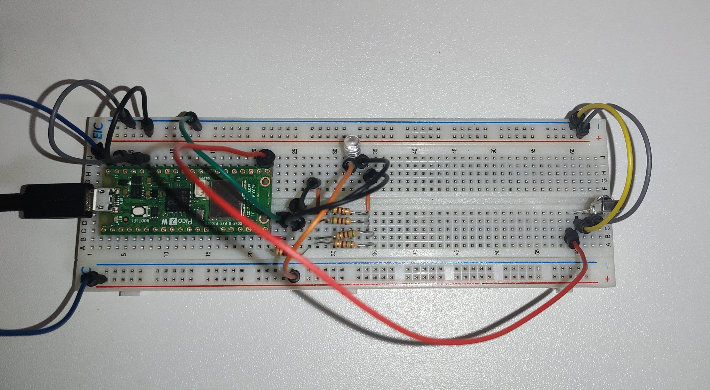

# pico-ir-controller

PCを使っているときに、リモコンを取らなくても部屋の照明を操作できるようにしたくて始めた電子工作。

Raspberry Pi Pico 2 WHから赤外線を送って、照明リモコンの代わりにする。電子工作の学習と、いずれ作りたい個人ロボットの入出力の練習も兼ねている。

## 今の状態



照明に向けて赤外線を送れば、LED1個でも点灯できた。

ただ、元のリモコンみたいに部屋のどこからでも、向きを気にせず操作できる状態にはならなかった。今回はそこまで作れなかったので、試作としては失敗。受信と送信の仕組みは動いたので、実験コードは残しておく。

詳しい経緯と結果は、[今回の試作記録](docs/2026-11-23-first-prototype.md)にまとめた。

## 使ったもの

- Raspberry Pi Pico 2 WH / MicroPython
- VS Code / MicroPico
- VS1838B（赤外線受信）
- 940nmの赤外線LED、C1815、抵抗、ブレッドボード
- [peterhinch/micropython_ir](https://github.com/peterhinch/micropython_ir)（ライブラリを使う送信テスト）

受信はGP16、送信はGP15を使っている。これは使用した照明向けの実験なので、別の照明で使う場合はリモコンの信号を読み取って確認する。

## ファイル

| ファイル | やっていること |
| --- | --- |
| [receiver_test.py](pico/receiver_test.py) | リモコンを受信して、アドレス・コマンド・反転値を取り出す |
| [transmitter_test.py](pico/transmitter_test.py) | GP15を0.5秒ずつON/OFFする回路確認。リモコン信号は送らない |
| [carrier_test.py](pico/carrier_test.py) | 38kHzの赤外線を出して、VS1838Bで0.1秒間検出する |
| [nec_sender_test.py](pico/nec_sender_test.py) | 手書きのPWM処理で、消灯信号を1秒ごとに送る |
| [pio_sender_test.py](pico/pio_sender_test.py) | ライブラリを使って、点灯信号を1回送る |
| [loopback_test.py](pico/loopback_test.py) | ライブラリで送った点灯信号を受け直して解析する |

`pio_sender_test.py`と`loopback_test.py`には、Pico側に`ir_tx`のインストールが必要。

PC側に`mpremote`をインストールし、MicroPicoを切断してから、PCのターミナルで実行した。

```powershell
py -m mpremote connect auto mip install "github:peterhinch/micropython_ir/ir_tx"
```

実行するときはMicroPicoへ再接続し、対象ファイルを開いて`MicroPico: Run Current File on Board`を使う。

PCアプリ、USBシリアルの命令受付、Wi-Fi操作はまだ作っていない。

配線を変えるときはUSBを抜く。LEDには電流制限抵抗と駆動回路を使い、家庭用100V配線や照明内部には触れない。
