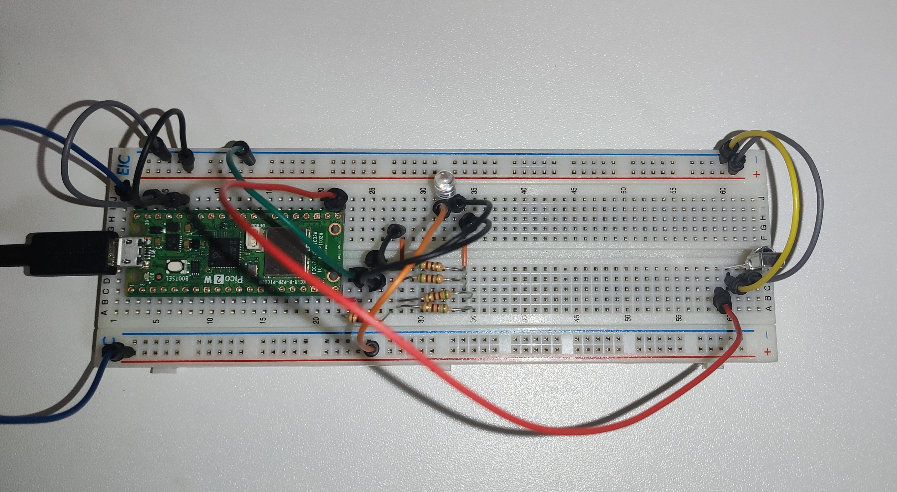

# 赤外線照明スイッチを作ってみた結果

2026年11月22日〜23日にやったことの記録。

今回は失敗。照明を操作すること自体はできたけど、元のリモコンみたいに、向きを気にせず部屋の中で使えるものにはできなかった。

何も動かなかったわけではないので、できたこととダメだったことを残しておく。



今回組んだ回路。Picoと赤外線LED、受信モジュールなどをブレッドボードでつないで試した。

## 何を作りたかったか

PCを使っているときに、わざわざ照明のリモコンを取らなくても電気をつけたり消したりしたかった。

最初は、PCのボタンからUSBシリアルでPicoへ命令を送って、Picoから照明に赤外線を出す構成を考えていた。

```text
PCのボタン → USBシリアル → Pico 2 WH → 赤外線LED → 照明
```

電子工作の勉強も目的だったので、最初から完成したコードを全部入れるのではなく、受信した値やコードの意味を確認しながら進めた。

## 今回やったこと

最初はPico本体のLEDを光らせるところから始めた。開発はThonnyではなく、VS CodeにMicroPicoを入れてやった。

次にVS1838Bをつないで、照明のリモコンを受信した。最初は数字が大量に出るだけだったけど、信号が続いている時間から0と1に分けて、8ビットずつ数値に直した。

ここで、`enumerate`や2進数から数値への変換、16進数、反転値の確認もやった。

読み取れた値はこれ。

| 操作 | アドレス | コマンド | 反転値 |
| --- | --- | --- | --- |
| 点灯 | `0x6D82` | `0x1F` | `0xE0` |
| 消灯 | `0x6D82` | `0x1E` | `0xE1` |

送信側は赤外線LEDとC1815で組んだ。まず自分で書いたPWM処理でNEC系の信号を送って、その後はタイミングの不確かさを減らすために`micropython_ir`の送信ライブラリを使った。

送った信号をVS1838Bでもう一度受け取るテストも作った。点灯信号は次の値になって、元のリモコンと一致した。

```text
bytes: ['0x82', '0x6d', '0x1f', '0xe0']
address: 0x6d82
command: 0x1f
command inverse: 0xe0
Valid command
```

少なくとも、今回受け取れた範囲では、送っている信号の中身は合っていた。

## LEDを増やしたけど、個数だけの問題ではなかった

最初は照明が反応しなかった。途中でLED4個にしたら、角度や距離を調整すればつくようになった。

元のリモコンにもLEDが4個あったので、「LEDを増やせばもっと届くのでは」と考えた。元のリモコンのLEDは4個とも同じ方向を向いていた。

8個版も組んでみたけど、そのときは赤外線検出が`False`になった。原因をはっきりさせられないまま複雑になったので、一度やり直すことにした。

今度はLED2個を直列にした1組だけ作って、動いたら次の組を追加する進め方にした。

組み直した2個版は赤外線検出が`True`になって、照明に向けたらついた。さらに、1個にしても照明へ向ければつくことが分かった。

つまり、「1個では無理で、4個必要だった」とは言えなかった。配線、向き、距離、抵抗なども途中で変わっていたので、LEDの個数だけを比べられていなかった。

抵抗の数が決め手なのかとも思ったけど、それもまだ分からない。同じ抵抗でも直列LEDを2個から1個に変えると電流も変わるので、次は条件をそろえて比べたい。

## ダメだったこと

一番ダメだったのは、照明の方にちゃんと向けないと操作しにくいこと。元のリモコンは違う方向へ向けても使えるので、その使い勝手を再現したかった。

手持ちの抵抗は510Ω、1kΩ、10kΩだけだった。小さい抵抗値を作るために510Ωを何本も並列にした結果、抵抗もジャンパ線も増えて、ブレッドボードがかなり組みにくくなった。

途中でLEDの個数や抵抗、配線を何度も変えたので、何を変えたから良くなったのかが追いにくくなった。AIに相談して出てきた回路図や改善案も何度か変わった。あとから考えると、まず1組だけで確認して進める方がよかった。

電流や電圧を測るテスターも持っていなかった。「約19mA」などの値は計算上の想定で、実際にその電流が流れていたかは確認できていない。

スマートフォンのカメラでも確認しようとしたけど、元のリモコンも自作LEDも見えなかった。そのカメラでは発光の比較はできなかった。

## USBが落ちたこともあった

回路を組んでUSBハブへつないだら、キーボードやマウスまで落ちたことがあった。

確認すると、5Vの接続先をC1815のEにしてしまっていた。USBを抜いて配線を直したら、周辺機器もMicroPicoの接続も復旧した。

これでトランジスタが傷んだかどうかまでは分かっていない。配線を変えるときにUSBを抜くことと、電源とGNDの接続は先に確認することを覚えておく。

## 買った部品が悪かったのか

今回の結果だけでは、そこまでは言えない。実際にLED1個でも照明はついた。

ただ、「940nmの赤外線LEDなら、元のリモコンと同じように使える」と考えるには確認する項目が足りなかった。光の強さ、広がる角度、流せる電流なども必要だった。

部屋のどこからでも操作するには、直接照明に向けた光だけでなく、壁や天井で反射した光でも届く必要がある。そのための光量が今回のLEDと回路で足りていたかは分からない。

なので、部品選びが悪かったと決めるより、必要な性能を確認しないまま組み始めて、測定もしないまま変更を重ねてしまったのが反省点。

## できたことと、次にやるなら

照明のリモコンを受信して、信号を数値にして、Picoから再現するところまではできた。LED1個でも照明をつけられたので、赤外線で操作する仕組み自体は動いた。

一方で、PCの操作画面、USBシリアルでの命令受付、Wi-Fi操作までは作っていない。今回の「点灯できた」は、VS Codeから送信テストを実行して操作できたという意味。

次に再開するとしたら、まずは動いた小さい回路を残して、一度に変えるのは1つだけにする。直接向けたときと、向けなかったときの距離や角度も記録する。

その上でテスターを使って電流を確認したい。部品を追加するなら、抵抗だけでなく、光出力や電流の条件が分かるLEDと駆動回路をセットで考える。TSAL6200やMOSFETの案も出たけど、まだ試していない。

今回は目的のものにはできなかった。でも、受信した数字を解析して照明がつくところまでやれたので、そのコードと結果は残しておく。
